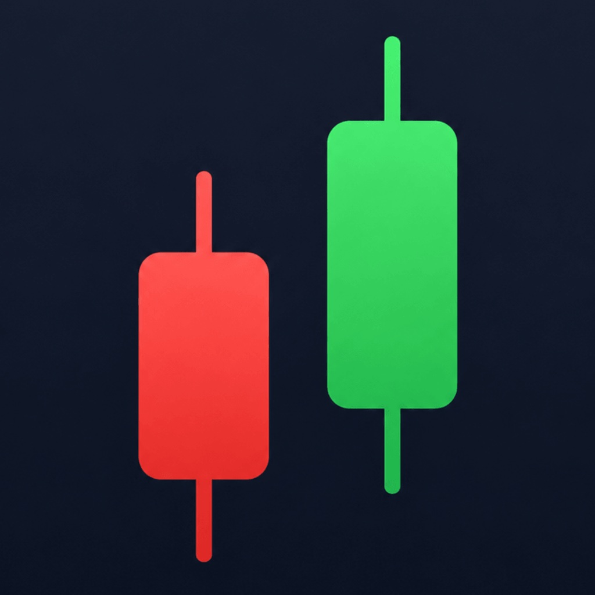
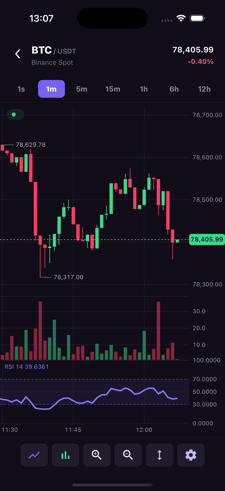
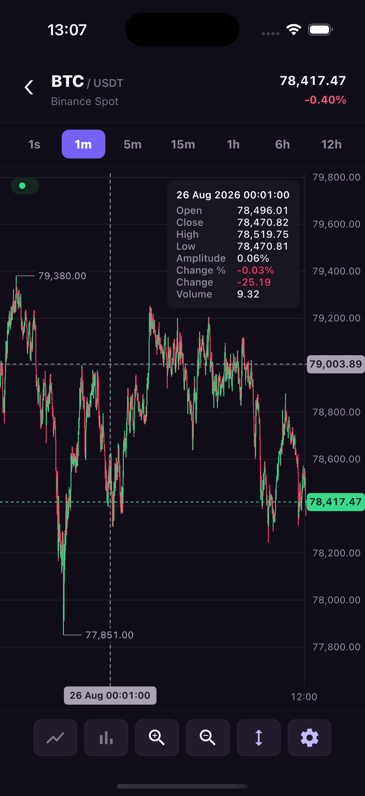
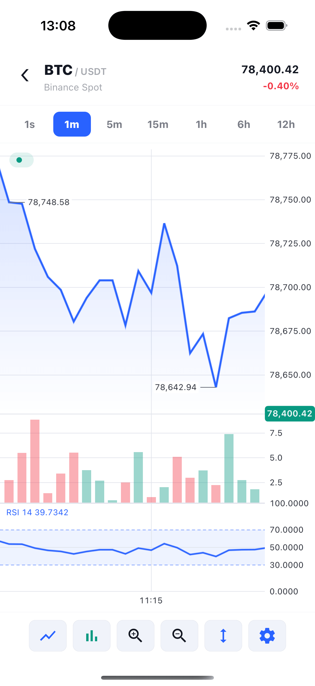
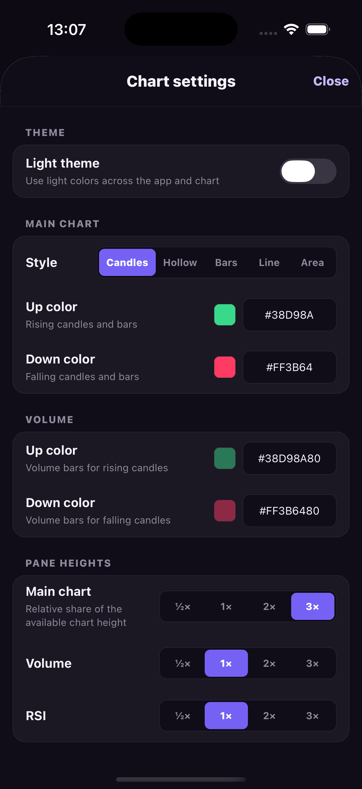

<p align="center">
  
</p>

# react-native-trading-charts

`react-native-trading-charts` is a high-speed, resource-efficient React Native
library for rendering live and historical trading data from traditional and
crypto markets. React owns configuration and data delivery; native code owns
chart state, gestures, geometry, and rendering.

The library uses a shared C++ chart and geometry engine, Metal on iOS, and
OpenGL ES 3 on Android. Frames are rendered on demand, immutable snapshots are
reused between updates, and high-frequency trade streams can be batched before
they cross the native boundary.

<p align="center">
  
  
  
  
</p>

## Why Native Trading Charts?

React Native trading charts are commonly built with either a WebView or a
general-purpose 2D engine such as Skia. Both are useful tools, but each carries
costs that are unnecessary for a purpose-built OHLC renderer.

A WebView embeds a browser runtime and its view lifecycle. Chart updates pass
through an additional execution context, while the browser still handles the
JavaScript, DOM, CSS, layout, and rendering pipeline required by the charting
application. That flexibility is valuable for reusing web charts, but it makes
native performance and resource usage harder to control.

Skia provides an extensive cross-platform 2D graphics API. Trading charts need
only a small subset of that functionality, while the application still carries
the runtime and memory cost of a general-purpose graphics engine.

`react-native-trading-charts` takes a narrower approach: trading semantics and
geometry live in a small shared C++ engine, while each platform uses its native
GPU API and native text stack. The result is designed specifically for dense,
frequently updated market data without introducing a browser or a third-party
2D rendering runtime.

## Key Features

- **Zero third-party runtime dependencies beyond React Native.** React and
  React Native are peer dependencies; the package does not add a browser,
  graphics framework, or utility runtime.
- **Shared C++ engine and geometry.** Candle storage, raw-trade aggregation,
  viewport behavior, autoscale, ticks, selection, and tessellation are shared
  by iOS and Android.
- **Native GPU rendering.** Metal renders on iOS and OpenGL ES 3 renders on
  Android.
- **Resource-efficient frames.** Rendering is on demand, unchanged snapshots
  are cached, and content geometry is reused for crosshair-only updates.
- **Multiple display types.** Candlestick, hollow candlestick, OHLC bar, line,
  area, and histogram series are supported.
- **Multiple panes and series.** Add independently scaled panes, derived volume,
  SMA, EMA, RSI, MACD, Williams %R and KDJ, comparison series, and custom histogram data.
- **Detailed presentation control.** Configure themes, role-specific styles,
  native number/date formatting, axes, badges, and tooltips.
- **Streaming-ready data APIs.** Send completed candles, raw trades, batches,
  or use the built-in trade batcher to reduce native calls.
- **Native interaction.** Pan, pinch zoom, Y-axis scaling, momentum, crosshair,
  current-price overlays, and visible extrema are handled natively.

## Table of Contents

- [Installation](#installation)
- [Chart Types](#chart-types)
- [Indicators and Panes](#indicators-and-panes)
- [Themes, Axes and Formatting](#themes-axes-and-formatting)
- [Gestures and Crosshair](#gestures-and-crosshair)
- [Price Markers and Overlays](#price-markers-and-overlays)
- [Live Data and API](#live-data-and-api)

## Installation

```sh
npm install react-native-trading-charts
```

Requires React Native 0.80+ with the New Architecture enabled. [Native setup and first chart](https://kirill3333.github.io/react-native-trading-charts/docs/getting-started.html) · [Documentation portal](https://kirill3333.github.io/react-native-trading-charts/)

## Chart Types

Choose filled or hollow candles, OHLC bars, a line, an area or a baseline chart. Switching the main series keeps its history and visible range.

The candlestick example shows each interval's open, high, low and close. Customize the rising and falling colors or round the candle bodies. The baseline example uses different line and fill colors on either side of a reference price. For line and area charts, choose the price field, stroke width and dash pattern.

<p>
  <a href="https://kirill3333.github.io/react-native-trading-charts/docs/series-types.html#candlestick"></a>
  <a href="https://kirill3333.github.io/react-native-trading-charts/docs/series-types.html#baseline"></a>
</p>

[Chart types and configuration examples](https://kirill3333.github.io/react-native-trading-charts/docs/series-types.html)

## Indicators and Panes

Overlay SMA, EMA, Bollinger Bands or Parabolic SAR on price. Give volume, RSI, MACD, Williams %R or KDJ their own panes. Each pane shares the time axis and has its own vertical scale.

The first example overlays two moving averages with different periods and line styles. The second places volume and RSI below price. You can set pane heights, allow users to drag the separators, change RSI thresholds and toggle each indicator's legend.

<p>
  <a href="https://kirill3333.github.io/react-native-trading-charts/docs/moving-averages.html"></a>
  <a href="https://kirill3333.github.io/react-native-trading-charts/docs/panes.html"></a>
</p>

[Moving averages](https://kirill3333.github.io/react-native-trading-charts/docs/moving-averages.html) · [Volume and histograms](https://kirill3333.github.io/react-native-trading-charts/docs/volume.html) · [RSI](https://kirill3333.github.io/react-native-trading-charts/docs/rsi.html) · [Pane layout](https://kirill3333.github.io/react-native-trading-charts/docs/panes.html)

## Themes, Axes and Formatting

- **Appearance.** Set the background, grid opacity and candle colors. Choose fonts and colors for axis labels, and adjust badge and tooltip borders.
- **Axes.** Use elapsed-time spacing to show gaps between sessions or space candles evenly across closures. Set axis dimensions and leave space above and below the visible price range.
- **Labels.** Choose a locale, time zone and date pattern. Use compact numbers for volume, set price precision to match the instrument, or show more decimals in the tooltip than on the axis.

<p>
  <a href="https://kirill3333.github.io/react-native-trading-charts/docs/styling.html"></a>
</p>

[Themes and appearance](https://kirill3333.github.io/react-native-trading-charts/docs/styling.html) · [Axes and value formatting](https://kirill3333.github.io/react-native-trading-charts/docs/axes.html)

## Gestures and Crosshair

Choose how many candles are visible at first, then enable horizontal pan, pinch zoom and vertical price scaling independently. A long press selects a candle. Choose solid or dashed crosshair lines, show or hide the time header, and pick the tooltip rows, their order and their labels.

<p>
  <a href="https://kirill3333.github.io/react-native-trading-charts/docs/crosshair.html"></a>
</p>

[Gestures and viewport](https://kirill3333.github.io/react-native-trading-charts/docs/gestures.html) · [Crosshair and tooltips](https://kirill3333.github.io/react-native-trading-charts/docs/crosshair.html)

## Price Markers and Overlays

Show the latest price with a line and an axis badge, pin the badge to the edge when its price is off-screen, or label the visible high and low. To mark an entry price or order target, add a horizontal line with your own price, color and label.

<p>
  <a href="https://kirill3333.github.io/react-native-trading-charts/docs/price-overlays.html"></a>
  <a href="https://kirill3333.github.io/react-native-trading-charts/docs/price-markers.html"></a>
</p>

[Current price and visible extremes](https://kirill3333.github.io/react-native-trading-charts/docs/price-overlays.html) · [Custom price markers](https://kirill3333.github.io/react-native-trading-charts/docs/price-markers.html)

## Live Data and API

Load candle history with `setHistory`, then call `updateCandle` as prices change. If your feed sends individual trades, `createTradeBatcher` groups them for delivery and the native engine aggregates them into candles at the chart's resolution.

The example shows one-minute candles with volume for each interval. Set the resolution to match your feed, align candles to the exchange open, and supply a calendar for holidays or shorter sessions.

<p>
  <a href="https://kirill3333.github.io/react-native-trading-charts/docs/time-aggregation.html"></a>
</p>

[Data and streaming](https://kirill3333.github.io/react-native-trading-charts/docs/data.html) · [Time and trade aggregation](https://kirill3333.github.io/react-native-trading-charts/docs/time-aggregation.html) · [Trade batcher](https://kirill3333.github.io/react-native-trading-charts/docs/api/trade-batcher.html)

[View props](https://kirill3333.github.io/react-native-trading-charts/docs/api/view.html) · [Commands](https://kirill3333.github.io/react-native-trading-charts/docs/api/commands.html) · [Events](https://kirill3333.github.io/react-native-trading-charts/docs/api/events.html)

---

[Example app](https://github.com/kirill3333/react-native-trading-charts/tree/main/example) · [Contributing](https://github.com/kirill3333/react-native-trading-charts/blob/main/CONTRIBUTING.md) · [MIT License](https://github.com/kirill3333/react-native-trading-charts/blob/main/LICENSE)
