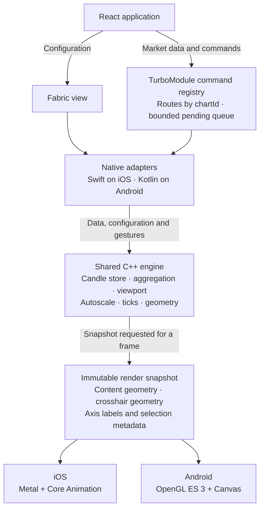

# Architecture & performance

A live chart has to keep drawing and responding to touch while market data arrives. This library puts the candle store, calculations and gestures in native code. React configures the view and sends data; it does not redraw the candles on each tick.

The shared C++ engine gives iOS and Android the same rules for aggregation, visible ranges and chart geometry. Each platform supplies its own renderer and text overlay: Metal with Core Animation on iOS, OpenGL ES 3 with Canvas on Android.

When connecting a fast feed or investigating performance, start by separating data processing from drawing. The chart requests frames when data or interactions change its state, so an idle screen does not need a continuous render loop.

The native registry finds the chart by `chartId`. If its view has not mounted,
the registry holds writes in a bounded queue. A change to data or gesture state
marks the current snapshot out of date and requests a frame. Multiple requests
before the next screen refresh share that frame. An idle chart does not
continuously render.

Snapshots are immutable and cached. Large content geometry and small overlay
geometry are tracked separately, so moving only the crosshair can reuse the
existing chart vertices. GPU buffers grow to capacity and are reused instead
of being recreated during steady-state interaction. For high-frequency feeds,
`updateTrades` and `createTradeBatcher` reduce bridge calls and engine
mutations.

For the command, revision and snapshot rules, read
[ChartEngine state and rendering protocol](https://github.com/kirill3333/react-native-trading-charts/blob/main/chart-engine-state-protocol.md).

On iOS, Swift talks to the shared engine through the private
`TradingChartsCxx` Clang module. Snapshot handles retain the underlying C++
`shared_ptr`, while vertex storage is exposed only through scoped Swift buffer
closures. The renderer copies from those buffers before the closure returns;
neither raw pointers nor C++ types cross the public Objective-C/Fabric API.
